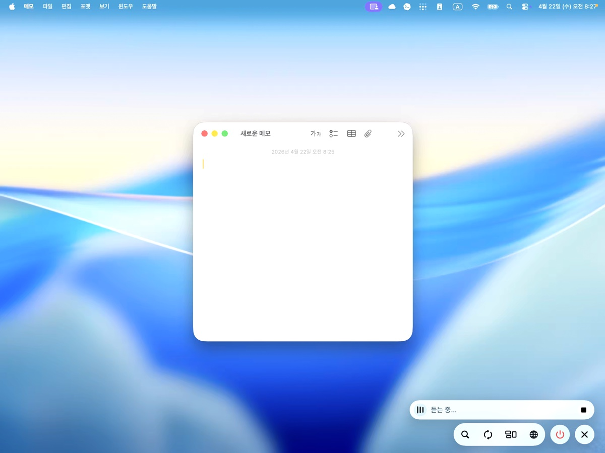
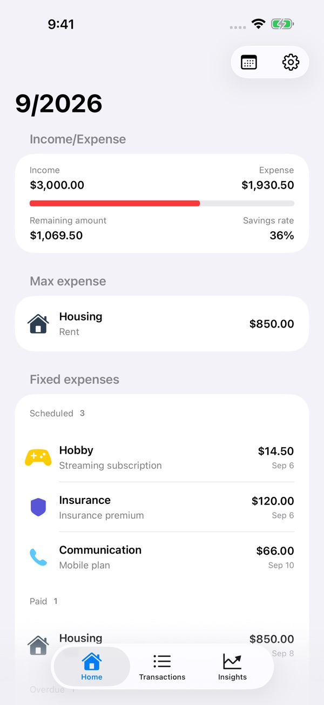
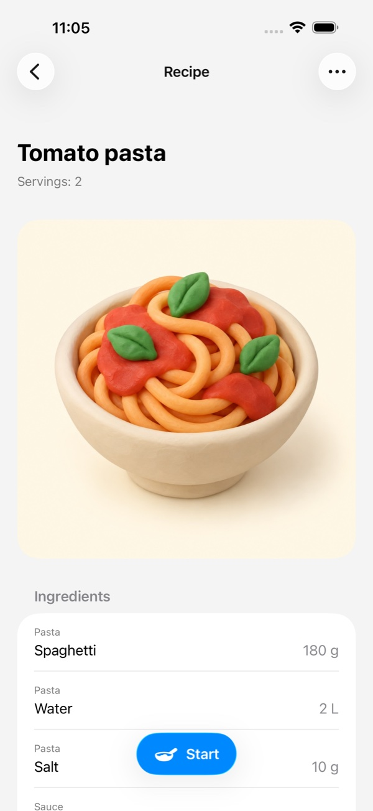

# Sangku Oh

I'm an iOS engineer in Seoul, focused on solving users' problems through the apps they use. I've been building iOS products since 2020, and now design, build, and run **Evoke, Kane, and hesti**.

[Apps & screenshots](https://kane-apps.kuromode.chatgpt.site/en/) · [LinkedIn](https://www.linkedin.com/in/sangku824/) · [Build notes on Threads](https://www.threads.com/@kuro_mode)

## Selected work

<table>
  <tr>
    <th><a href="https://apps.apple.com/app/id6760531983">Evoke</a></th>
    <th><a href="https://apps.apple.com/app/id6757577312">Kane</a></th>
    <th><a href="https://apps.apple.com/app/id6810463460">hesti</a></th>
  </tr>
  <tr>
    <td align="center"></td>
    <td align="center"></td>
    <td align="center"></td>
  </tr>
</table>

### Evoke — use your Mac from iPad or iPhone

I built both the macOS host and the iOS client, from finding a nearby Mac to streaming its screen and audio and sending touch and keyboard input back.

- Bonjour discovery and direct QUIC/TLS sessions with Network.framework; screen and media processing with ScreenCaptureKit and VideoToolbox.
- Ongoing work on connection recovery, video and audio handling, testing, localization, and App Store releases.

[App Store](https://apps.apple.com/app/id6760531983) · [Early demo video](https://www.threads.com/@kuro_mode/post/DWsGsJjD0RR) · [RemotePad → Evoke](https://www.threads.com/@kuro_mode/post/DdP5XNFj843)

The demo shows RemotePad 2.0, the app's earlier name and version.

### Kane — a ledger for everyday spending

I built Kane for manual income and expense tracking, recurring costs, and shared household ledgers. SwiftData and CloudKit connect the records across devices; widgets and App Intents make it easier to return to them.

Kane reached No. 1 in the all-apps paid chart shown in my [public chart screenshot](https://www.threads.com/@kuro_mode/post/DUAolkpjwPe), posted on January 27, 2026.

[App Store](https://apps.apple.com/app/id6757577312) · [Calendar feature walkthrough](https://www.threads.com/@kuro_mode/post/DURdSt0kywH)

### hesti — keep a recipe, then cook from it

I built a recipe notebook that carries ingredients and instructions into a guided cooking flow, with step timers, iCloud sync, and an Apple Watch companion. I also handle the free and one-time Pro purchase options, localization, and store presentation.

[App Store](https://apps.apple.com/app/id6810463460) · [Early cooking-flow video](https://www.threads.com/@kuro_mode/post/DdIJilgD6Hm)

## Beyond the apps

- **Business tools:** an internal ERP sales and inventory dashboard that reconciles totals before publishing new data, plus an order-review tool that compares chat orders with manually entered records.
- **Open source:** [Build AndroidOS Apps](https://github.com/SangkuOh/build-androidos-apps) and [Build Flutter Apps](https://github.com/SangkuOh/build-flutter-apps), Codex plugins with workflows and helpers for building, inspecting, and profiling apps.
- **Earlier product work:** iOS skin and hair analysis apps with BLE/Wi-Fi device integration at lululab; the iOS/iPadOS app for **SOURCE**, a shared reference and image archive for designers and planners.

## What I care about

As an iOS engineer, I'm interested in understanding the problems people run into and solving them on the client side. I care about how an app's features and interactions help people do what they came to do, and improving them through actual use and feedback.

A recent [delivery-log prototype](https://www.threads.com/@kuro_mode/post/Del7uycjwYp) started with drivers sharing delivery times and photos in a chat. It's a work in progress, with a public demo rather than a released product.
