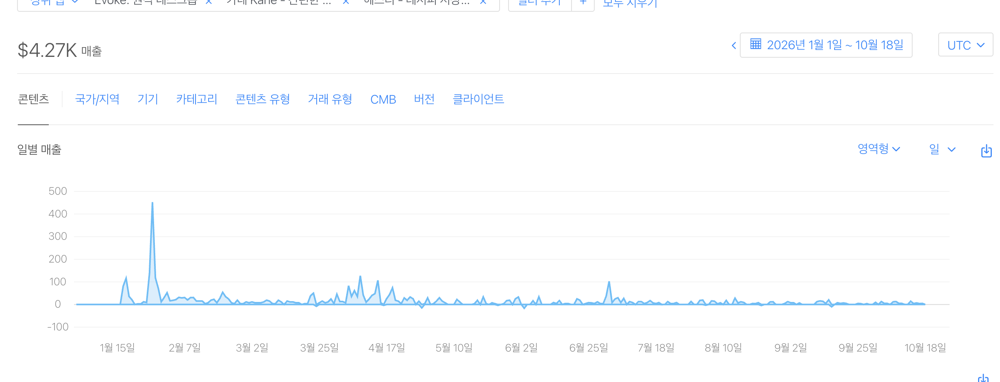

# Sangku Oh

I'm an iOS engineer in Seoul, focused on solving users' problems through the apps they use. I've been building iOS products since 2020, and now design, build, and run **Evoke, Kane, and hesti**.

[Apps & screenshots](https://kane-apps.kuromode.chatgpt.site/en/) · [LinkedIn](https://www.linkedin.com/in/sangku824/) · [Build notes on Threads](https://www.threads.com/@kuro_mode)

## Results

- **US$4,274.15 in combined App Store sales** across Evoke, Kane, and hesti, January 1–October 18, 2026 (UTC). This is App Store Connect's estimated USD Sales, including apps and in-app purchases, not developer proceeds.
- **No. 1 on the App Store's overall paid-app chart — Kane.** [Public chart record](https://www.threads.com/@kuro_mode/post/DUAolkpjwPe), posted January 27, 2026.
- **No. 1 in Utilities and No. 9 overall on the paid iPad app charts — Evoke, then named RemotePad.** [Original ranking screenshots](https://www.threads.com/@kuro_mode/post/DWtglgtj5zh), posted April 4, 2026.
- **Three apps independently built, released, and operated**, including store submissions, localization, customer support, and updates after launch.

  
Combined sales record

  

  The dashboard rounds the total to US$4.27K. The aggregate daily export sums to US$4,274.15, including negative adjustments.

## Selected work

<table>
  <tr>
    <th><a href="https://apps.apple.com/app/id6760531983">Evoke</a></th>
    <th><a href="https://apps.apple.com/app/id6757577312">Kane</a></th>
    <th><a href="https://apps.apple.com/app/id6810463460">hesti</a></th>
  </tr>
  <tr>
    <td align="center"></td>
    <td align="center"></td>
    <td align="center"></td>
  </tr>
</table>

### Evoke — use your Mac from iPad or iPhone

Evoke is for people who want to work with their Mac's documents and apps from an iPad or iPhone. I built both the Mac app and the iOS client, connecting device discovery, screen and audio streaming, and touch and keyboard controls into one flow.

I also worked on the less visible parts of that experience: explaining required permissions and connection failures, and helping users reconnect when a session ends.

**Result:** independently built and released both sides as a paid product; reached **No. 1 in Utilities and No. 9 overall on the paid iPad app charts** under its original name, RemotePad. The [original ranking screenshots](https://www.threads.com/@kuro_mode/post/DWtglgtj5zh) were posted April 4, 2026. I continue to operate Evoke, handling localization, releases, customer questions, and improvements after launch.

[App Store](https://apps.apple.com/app/id6760531983) · [Early demo video](https://www.threads.com/@kuro_mode/post/DWsGsJjD0RR) · [RemotePad → Evoke](https://www.threads.com/@kuro_mode/post/DdP5XNFj843)

The demo shows RemotePad 2.0, the app's earlier name and version.

### Kane — a ledger for everyday spending

Kane helps people keep track of their own spending and shared household costs without repeatedly entering the same expenses or comparing separate records.

I brought manual income and expense entry, recurring transactions, and shared ledgers together. Records follow the user across devices, while widgets and Siri provide shorter paths to adding an entry. Statistics and backup tools help people review and keep their records.

**Result:** independently designed, built, and released as a paid app; reached **No. 1 on the overall paid-app chart**, documented in my [public chart screenshot](https://www.threads.com/@kuro_mode/post/DUAolkpjwPe), posted January 27, 2026.

[App Store](https://apps.apple.com/app/id6757577312) · [Calendar feature walkthrough](https://www.threads.com/@kuro_mode/post/DURdSt0kywH)

### hesti — keep a recipe, then cook from it

hesti helps people use the recipes they save when it is time to cook. I connected ingredients and instructions to a guided cooking flow with step timers, so a recipe can carry someone from preparation through each cooking step.

Recipes sync through iCloud, and cooking progress can be checked from the Lock Screen and Apple Watch.

**Result:** released a product spanning iPhone, iPad, and Apple Watch, with Korean, English, and Japanese support. Core cooking and sync features are free; a one-time Pro purchase removes the recipe limit. I handle both development and ongoing store operations.

[App Store](https://apps.apple.com/app/id6810463460) · [Early cooking-flow video](https://www.threads.com/@kuro_mode/post/DdIJilgD6Hm)

## Beyond the apps

- **Business tools:** built an internal dashboard so staff can view sales and inventory together and trace figures back to ERP records. It checks totals before publishing and keeps the last verified data when a check fails. A separate order-review tool prepares chat orders for comparison with manually entered sales records; people still enter the final sales documents.
- **Open source:** [Build AndroidOS Apps](https://github.com/SangkuOh/build-androidos-apps) and [Build Flutter Apps](https://github.com/SangkuOh/build-flutter-apps) help developers and coding agents build, inspect, and profile apps through repeatable workflows.
- **SOURCE:** co-developed and operated an iOS/iPadOS app for designers and planners who need to collect references and discuss them in context. Image comments, shared workspaces, and public links keep feedback with the material it refers to. The team was selected for Korea's 2024 Preliminary Startup Package.
- **lululab:** built client flows that connect beauty devices and external cameras to skin and hair analysis. My work covered device control, live camera previews, analysis results, and the connection and permission states users need to understand.

## What I care about

As an iOS engineer, I'm interested in understanding the problems people run into and solving them on the client side. I care about how an app's features and interactions help people do what they came to do, and improving them through actual use and feedback.

A recent [delivery-log prototype](https://www.threads.com/@kuro_mode/post/Del7uycjwYp) started with drivers sharing delivery times and photos in a chat. It's a work in progress, with a public demo rather than a released product.
